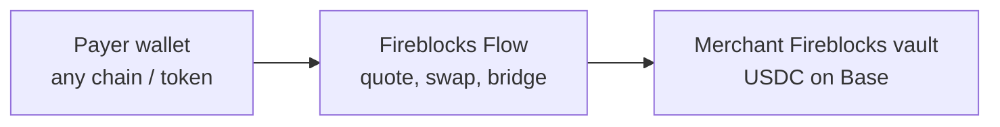
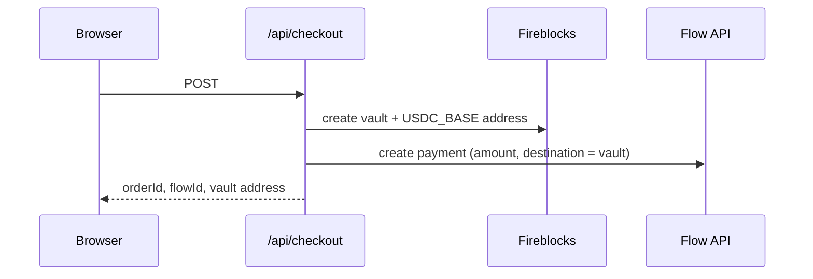
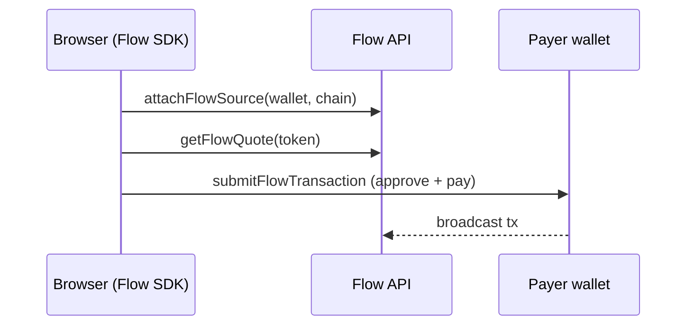
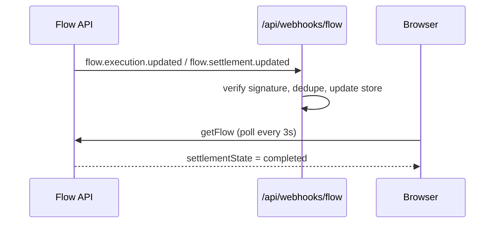
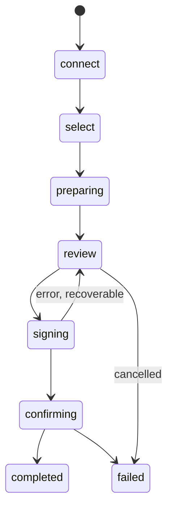

# Fireblocks Flow Checkout POC

A Next.js proof of concept for KAST. A customer pays for an order from their own crypto wallet using any supported chain/token, and the funds settle as **USDC on Base** into a dedicated **Fireblocks vault** for that order.

## What is Fireblocks Flow?

Fireblocks Flow (powered by Dynamic) is a payment orchestration layer for crypto. The merchant says *"I want to receive X USD, settled as token T on chain C, into address A"*, and Flow handles everything between the payer's wallet and that destination:

- **Any-to-one payments**: the payer can pay with a different token or chain (e.g. ETH on Arbitrum, SOL on Solana), and Flow quotes and routes the swap/bridge.
- **Quotes**: the exact amount the payer sends, fees, and an expiry time.
- **Transaction building**: chain switching, ERC-20 approvals and the payment transaction, signed by the payer's wallet.
- **Tracking**: two state machines (execution on the source chain, settlement at the destination), exposed via API polling and signed webhooks.



## What's included

| Area | Description | Files |
|---|---|---|
| Checkout UI | Custom React widget: connect wallet, pick network/token, review quote, sign, track | [components/WalletPaymentWidget.tsx](components/WalletPaymentWidget.tsx), [components/CheckoutApp.tsx](components/CheckoutApp.tsx) |
| Payment history | Browser-local history of past payments, refreshed from Flow | [components/PaymentHistory.tsx](components/PaymentHistory.tsx), [lib/payment-history.ts](lib/payment-history.ts) |
| Checkout API | Creates a Fireblocks vault per order, then a Flow payment settling into it | [app/api/checkout/route.ts](app/api/checkout/route.ts) |
| Webhook handler | Verifies HMAC signature, deduplicates events, updates payment state | [app/api/webhooks/flow/route.ts](app/api/webhooks/flow/route.ts) |
| Fireblocks integration | Vault + deposit address creation via `@fireblocks/ts-sdk` | [lib/server/fireblocks.ts](lib/server/fireblocks.ts) |
| Flow integration | Server-side Flow creation (REST) | [lib/server/dynamic.ts](lib/server/dynamic.ts) |
| Supported source networks | Base, Ethereum, Arbitrum, Solana (USDC / USDT / native) | [lib/networks.ts](lib/networks.ts) |

**SDKs used**

- `@dynamic-labs-sdk/client` (+ `/evm`, `/solana`): headless Flow SDK in the browser (`attachFlowSource`, `getFlowQuote`, `submitFlowTransaction`, `getFlow`, `cancelFlow`). No prebuilt Flow UI is used.
- `@fireblocks/ts-sdk`: server-side vault management.

**POC limitations**

- The order amount is fixed at `0.10` USD ([lib/order.ts](lib/order.ts)).
- Payment state is held in memory ([lib/server/payment-store.ts](lib/server/payment-store.ts)) and lost on restart.
- Order fulfilment on settlement is only logged.

## How it works

### 1. Create the payment



### 2. Quote, sign and submit



### 3. Track settlement



### Payment phases in the UI



## Running locally

### Prerequisites

- Node.js 18.18+ and [pnpm](https://pnpm.io)
- A Fireblocks **sandbox** workspace with an API user (API key + RSA private key)
- A Dynamic environment with Fireblocks Flow enabled, an API token with `flow.write` scope, and a webhook configured
- A browser wallet (e.g. MetaMask, Phantom) with a small balance on a supported network

### Setup

```bash
pnpm install
cp .env.example .env.local
```

Fill in `.env.local`. **Never commit this file**; it is git-ignored.

| Variable | Description |
|---|---|
| `FIREBLOCKS_API_KEY` | Fireblocks API user key |
| `FIREBLOCKS_SECRET_KEY` | API user's RSA private key (PEM; multi-line in quotes or single line with `\n`) |
| `FIREBLOCKS_BASE_PATH` | Defaults to the Fireblocks sandbox |
| `FIREBLOCKS_ASSET_ID` | Fireblocks asset matching the settlement token (default USDC on Base) |
| `DYNAMIC_API_TOKEN` | Dynamic environment API token (server only) |
| `DYNAMIC_WEBHOOK_SECRET` | Webhook signing secret from the Dynamic console |
| `NEXT_PUBLIC_DYNAMIC_ENVIRONMENT_ID` | Dynamic environment ID (public) |
| `SETTLEMENT_*` | Settlement chain/token; defaults to USDC on Base (8453) |

### Run

```bash
pnpm dev
```

Open http://localhost:3000.

### Webhooks (optional)

The UI polls Flow directly, so the app works without webhooks. To receive them locally, expose port 3000 with a tunnel (e.g. `ngrok http 3000` or `cloudflared tunnel --url http://localhost:3000`) and set the webhook URL in the Dynamic console to:

```
https://<your-tunnel-host>/api/webhooks/flow
```

Subscribe to `flow.execution.updated` and `flow.settlement.updated`.

### Production build

```bash
pnpm build
pnpm start
```
